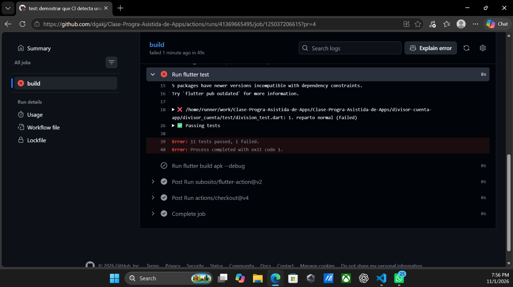

# Deber 4 — CI del divisor de cuenta

## 1. Workflow

```yaml
name: Flutter CI

on:
  push:
    branches:
      - main
  pull_request:

jobs:
  build:
    runs-on: ubuntu-latest
    defaults:
      run:
        working-directory: divisor-cuenta-app/divisor_cuenta
    steps:
      - uses: actions/checkout@v4
      - uses: subosito/flutter-action@v2
        with:
          channel: stable
      - run: flutter pub get
      - run: flutter analyze
      - run: flutter test
      - run: flutter build apk --debug

  entrega:
    needs: build
    if: github.event_name == 'push' && github.ref == 'refs/heads/main'
    runs-on: ubuntu-latest
    defaults:
      run:
        working-directory: divisor-cuenta-app/divisor_cuenta
    steps:
      - uses: actions/checkout@v4
      - uses: subosito/flutter-action@v2
        with:
          channel: stable
      - run: flutter pub get
      - run: flutter build apk --debug
      - uses: actions/upload-artifact@v4
        with:
          name: divisor-cuenta-apk-debug
          path: divisor-cuenta-app/divisor_cuenta/build/app/outputs/flutter-apk/app-debug.apk
```

- `analyze`: revisa el código Dart y reporta errores estáticos.
- `test`: ejecuta las pruebas automatizadas.
- `build`: genera el APK de depuración si los pasos anteriores pasan.

## 2. Falla de la Parte 3

El log señaló `divisor_cuenta/test/division_test.dart: 1. reparto normal (failed)` y resumió: `11 tests passed, 1 failed`.



## 3. CI y CD

CI integra cambios y ejecuta comprobaciones. Continuous delivery deja una versión lista para descargar o publicar. Continuous deployment publica automáticamente a producción. Implementé CI y entrega del APK como artefacto; no hice despliegue externo.

## 4. Protección de `main`

Una protección efectiva exige PR y checks verdes antes de fusionar, evitando que un cambio con pruebas fallidas rompa `main`.

**Captura pendiente:** la evidencia disponible de protección dice que la regla se aplica a `0 branches`; la captura del PR fallido muestra el botón de merge disponible. No prueban un merge bloqueado. Hay que corregir la regla para que aplique a `main` y guardar esa captura.

## 5. Revisión del agente

El agente recomendó permisos mínimos, fijar las acciones a SHA verificados, fijar una versión de Flutter y hacer fallar la entrega si no encuentra el APK. Acepté subir el APK con `actions/upload-artifact`, que verifiqué en el repositorio oficial. Dejé las mejoras de SHA y versiones para después; no añadí paquetes ni acciones nuevas sin verificar.

## 6. Qué garantiza un CI verde

Garantiza que los comandos configurados pasaron en ese commit y runner; no que todos los comportamientos sean correctos. Por ejemplo, un error al dividir montos con muchos decimales puede pasar si ningún test cubre ese caso.

## 7. Qué detectó el pipeline

Detectó la regresión intencional: el caso `1. reparto normal` esperaba `27.50`, pero cambié el esperado a `27.00` y el test falló. Antes también detectó que el workflow apuntaba a una carpeta sin el `pubspec.yaml` correcto. La protección de GitHub, aparte del pipeline, bloqueó un intento de subir un token OAuth guardado en un historial de Chrome generado.

## Evidencias

- [CI verde tras restaurar la prueba](evidencias/parte3_verde_otra_vez.jpeg)
- [APK subido como artifact](evidencias/parte4_artifact.jpeg)
- [Configuración de protección (la regla no aplicaba a ramas)](evidencias/parte1_ci_verde.jpeg)
- [PR fallido (la captura muestra merge disponible)](evidencias/parte2_proteccion.jpeg)

Falta una captura real del merge bloqueado con la regla aplicada a `main`.
